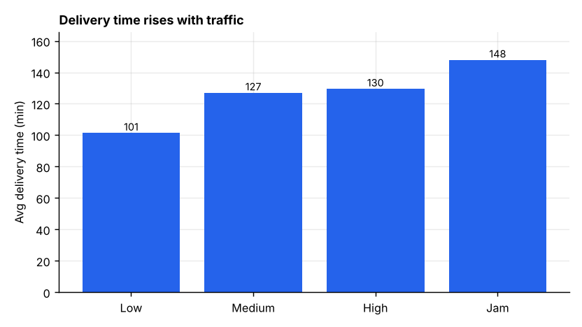
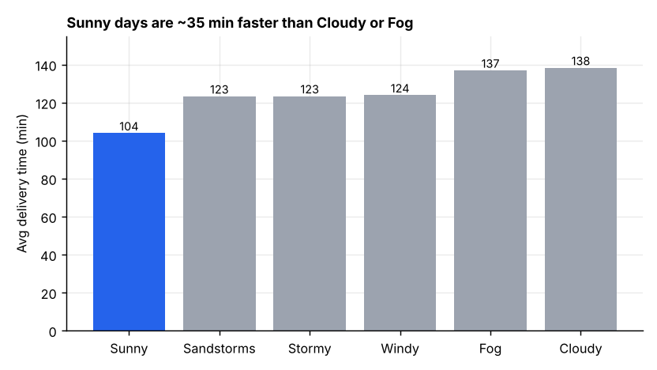
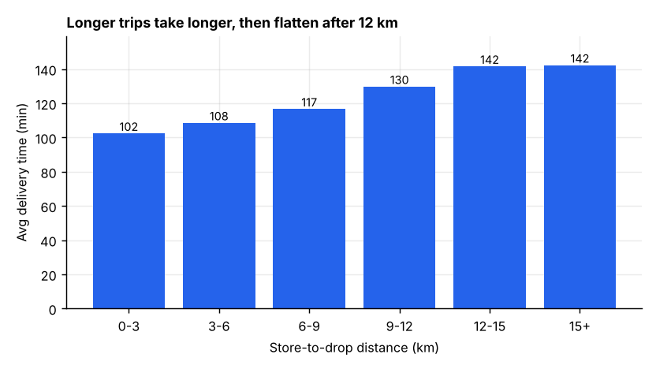
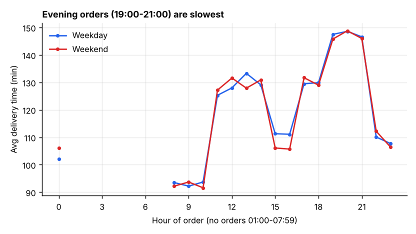
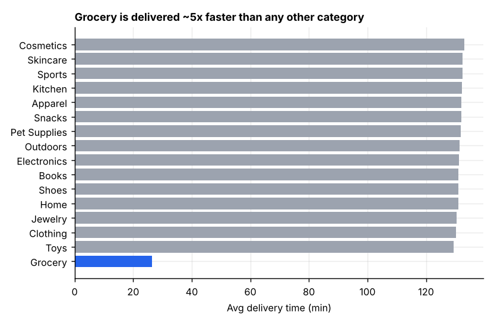
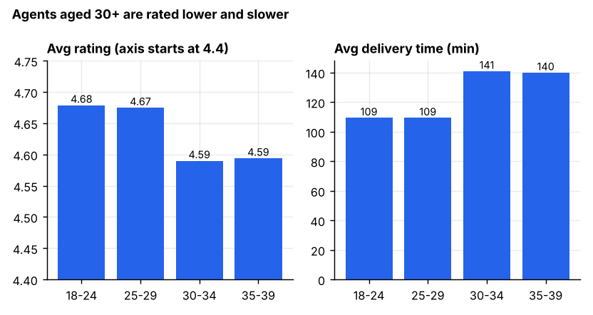
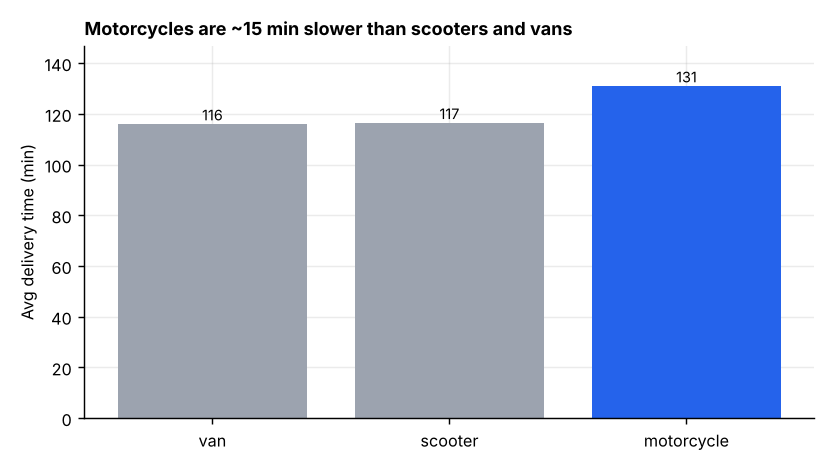
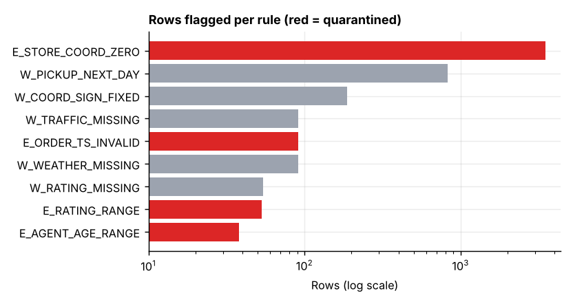

# Findings

_Generated by `python -m pipeline.report` from the loaded warehouse on 11 Oct 2026; every number below is queried, not typed._

**Scope.** 40,153 clean trips (of 43,739 raw rows; 3,586 quarantined, see "Data quality"). Averages are delivery minutes unless stated. These are associations in observational data, not proven causes.

| Avg delivery | Avg rating | Avg distance | Corr(distance, time) | Corr(rating, time) |
|---|---|---|---|---|
| 125.1 min | 4.63 | 9.71 km | 0.278 | -0.310 |

## 1. Traffic is the clearest driver

Low traffic averages **101 min**; Jam averages **148 min** (+46 min, 46% slower). High and Medium sit between (130 / 127).
Semi-Urban is an outlier (240 min in Jam) but has only 138 trips and none in Low traffic, so treat it as noise.

## 2. Weather: Sunny is fast; Cloudy and Fog are slow

Sunny **104 min** vs Cloudy **138** and Fog **137**; Stormy, Windy and Sandstorms cluster near 123.
Ratings barely move with weather (4.61 to 4.66), so weather changes speed but not how agents are rated.

## 3. Distance matters, with diminishing returns

Time rises from **102 min** (under 3 km) to **142 min** (12-15 km) and then flattens (142 min beyond 15 km). Overall correlation is only 0.278: distance alone is a weak predictor next to traffic and weather.

## 4. Time of day

On weekdays the slowest order hour is **20:00** (149 min) and the fastest is **09:00** (92 min).

## 5. Category: Grocery is a different service

Grocery averages **26 min**; every other category is 129-133 min. That gap is far larger than any weather or traffic effect, which suggests Grocery runs on a different fulfilment model (or is recorded differently). Worth confirming with the data owner before drawing operational conclusions.

## 6. Agents: age, rating and speed

There is a step at age 30. Agents under 30 average rating **4.68-4.67** and **109 min**; agents 30+ average **4.59-4.59** and **141-140 min**. Rating and delivery time are negatively correlated (-0.310): slower deliveries are rated lower.
The age effect is consistent across the 30-39 range, which is unusual for real-world behaviour; check how this field was recorded before acting on it.

## 7. Vehicles

Motorcycle **131 min** vs scooter **117** and van **116**. The gap holds at every traffic level. Bicycle does not appear: all 15 raw bicycle rows are corrupted and quarantined.

## 8. Cities
Bengaluru: **3,047 trips** from 20 stores, avg 124.9 min (p90 195.0).

| City | Trips | Stores | Avg min | P90 min |
|---|---|---|---|---|
| Jaipur | 3,307 | 20 | 127.1 | 200.0 |
| Coimbatore | 3,050 | 20 | 125.5 | 195.0 |
| Bengaluru | 3,047 | 20 | 124.9 | 195.0 |
| Surat | 3,046 | 20 | 123.6 | 195.0 |
| Hyderabad | 3,045 | 20 | 124.8 | 195.0 |
| Mumbai | 3,037 | 20 | 124.0 | 195.0 |
| Indore | 3,029 | 20 | 123.9 | 195.0 |
| Chennai | 2,995 | 20 | 125.7 | 195.0 |
| Pune | 2,988 | 20 | 124.7 | 195.0 |
| Mysuru | 2,877 | 19 | 122.5 | 195.0 |

## Data quality

Raw 43,739 = loaded 40,153 + quarantined 3,586.

| Rule | Severity | Rows | % |
|---|---|---|---|
| `E_STORE_COORD_ZERO` | error | 3,505 | 8.01% |
| `W_PICKUP_NEXT_DAY` | warn | 828 | 1.89% |
| `W_COORD_SIGN_FIXED` | warn | 188 | 0.43% |
| `W_TRAFFIC_MISSING` | warn | 91 | 0.21% |
| `E_ORDER_TS_INVALID` | error | 91 | 0.21% |
| `W_WEATHER_MISSING` | warn | 91 | 0.21% |
| `W_RATING_MISSING` | warn | 54 | 0.12% |
| `E_RATING_RANGE` | error | 53 | 0.12% |
| `E_AGENT_AGE_RANGE` | error | 38 | 0.09% |
